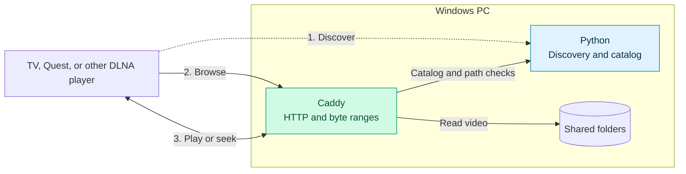

# Local Media Relay

Share a few Windows folders and play the videos from a TV, Quest, or other device with a DLNA player.

## Run it

You’ll need Python 3.11+ with Tkinter and `pythonw.exe` on PATH, plus Caddy. Put the native `caddy.exe` on PATH or in `tools/`. Chocolatey installs are also picked up.

Open **Start Local Media Relay.cmd**, add folders, and click **Start sharing**. On the player, look for **Local Media Relay** under network media sources. Folder selections are saved for the next launch. The `fixtures/` folders contain two short test clips.

Sharing is unauthenticated. Use a trusted LAN and share only folders you want reachable from other devices.

## How it works

Python checks which files can be shared. Caddy serves the bytes and handles HTTP details such as ranges and `If-Range`. The folder picker starts and stops both together. [Caddy file server](https://caddyserver.com/docs/caddyfile/directives/file_server) · [Caddy implementation](https://github.com/caddyserver/caddy/blob/v2.11.1/modules/caddyhttp/fileserver/staticfiles.go)

| Choice | Why |
| --- | --- |
| DLNA over manual URLs | Use the player’s existing network library. |
| Tkinter and JSON over a browser UI | A native folder picker and a saved list are enough. |
| Caddy over serving bytes in Python | One HTTP listener handles file serving, forwards catalog requests, and logs both. Python’s basic file handler was faster on a single full read in the [loopback benchmark](benchmark.py). A Go helper could also handle ranges, but it would need its own routing and logging code. [Go ServeContent](https://pkg.go.dev/net/http#ServeContent) |

## Testing

Run `python -B -m unittest discover -s tests -v` for the offline regression tests.
Run `python -B smoke.py` for the synthetic discovery, browse, and seek checks. The [test checklist](REQUIREMENTS.md) tracks what’s left, including 50–100 GB files, VR and alpha playback on compatible players, and JPEG/PNG support.
